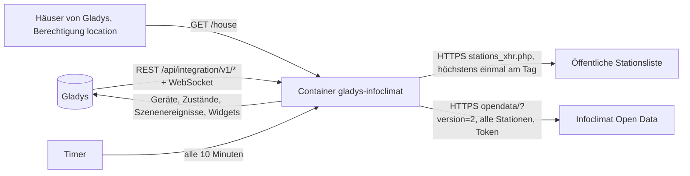
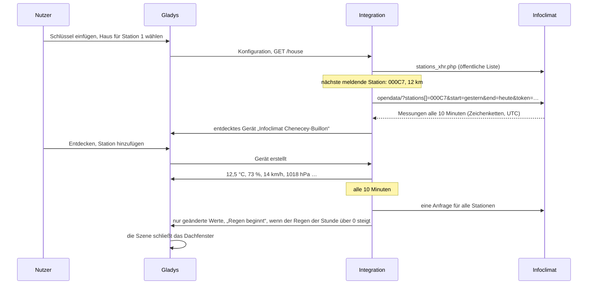
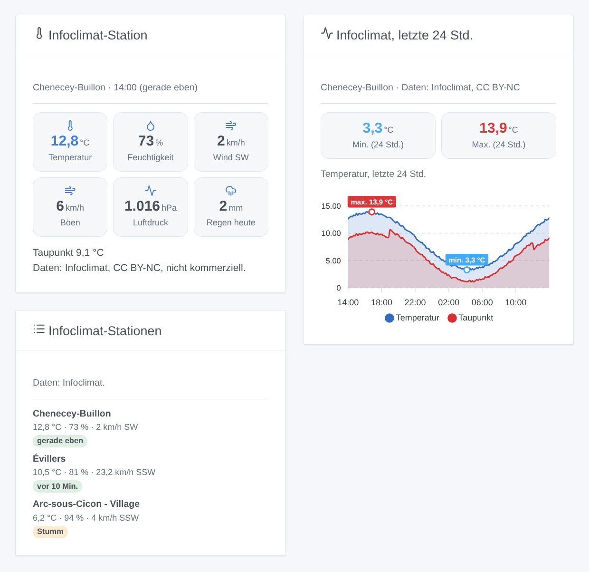

# Gladys Infoclimat

[English](README.md) · [Français](README.fr.md) · **Deutsch** · [Español](README.es.md)

[](LICENSE)
[](https://github.com/William-De71/gladys-infoclimat/releases)
[](https://github.com/William-De71/gladys-infoclimat/actions/workflows/release.yml)
[](https://gladysassistant.com)


Externe Integration für [Gladys Assistant](https://gladysassistant.com) für die Wetterstationen von [Infoclimat](https://www.infoclimat.fr), dem französischen Verein, dessen Mitglieder ihre Stationen teilen (das StatIC-Netz): Temperatur, Luftfeuchtigkeit, Luftdruck, Wind, Regen und mehr von den Stationen nahe deinen Häusern, als Geräte, Szenen und Dashboard-Widgets. Sie liest die Open-Data-API von Infoclimat mit deinem eigenen kostenlosen Schlüssel, sparsam: eine Anfrage für alle Stationen alle 10 Minuten.

Benutzerdokumentation: [English](docs/en.md) · [Français](docs/fr.md) · [Deutsch](docs/de.md) · [Español](docs/es.md).

Nicht mit Infoclimat verbunden. **Noch nicht mit einem echten Infoclimat-Schlüssel getestet**: Die Anfragen folgen der Open-Data-API, geprüft an ihren echten Antworten ohne Schlüssel; die öffentliche Stationsliste wurde tatsächlich gelesen.

## Funktionen

- Bis zu **drei Stationen**: die nächste StatIC-Station eines Hauses in Gladys, die in den letzten 24 Stunden gemeldet hat, oder eine über ihre Kennung gewählte Station (offizielle Stationen eingeschlossen).
- **Ein Gerät pro Station**, nur mit den Werten, die sie liefert: Temperatur, Luftfeuchtigkeit, Luftdruck auf Meereshöhe, Taupunkt, mittlerer Wind, Böen, Windrichtung, Regen der letzten Stunde, Regen heute, Schneehöhe, Sichtweite. Eine einmal gelieferte Funktion verschwindet nie.
- **5 Szenenauslöser** (Regen beginnt / hört auf, Station stumm / wieder da, Schlüssel abgelehnt), **1 Szenenaktion** (eine Station lesen, mit einem Satz für eine Nachricht) und **3 Dashboard-Widgets** (letzte Messung, letzte 24 Stunden eines Werts, Stationen nebeneinander).
- **Faire Nutzung** einer ehrenamtlichen Plattform: eine gebündelte Anfrage alle 10 Minuten (15, 30 oder 60), ein erkennbarer User-Agent, kein Ansturm beim Start, längere Pausen nach Fehlern.
- Die Quellenangabe Infoclimat und die Lizenz jeder Station in den Widgets.
- Vier Sprachen überall: Englisch, Französisch, Deutsch, Spanisch.

## Funktionsweise




Vom Haus zur Szene:



### Transport

`transports: ["cloud"]`: Die Messwerte kommen von Infoclimat. **Die Kennungen deiner Stationen und dein Schlüssel werden an Infoclimat gesendet**; der Standort deiner Häuser verlässt Gladys nie (die nächste Station wird in der öffentlichen Liste gesucht, innerhalb der Integration). Das Lesen der Häuser braucht die Berechtigung `location`, die bei der Installation angezeigt wird. `/data` behält die letzten 26 Stunden an Messungen jeder Station, die von jeder gelieferten Werte, die öffentliche Stationsliste und die Zeit der letzten Anfrage.

## Geräte und Funktionen

| Gerät            | Funktionen (Kategorie / Typ)                                                                                                                                                                                                                                                                                                                                                                        |
| ---------------- | --------------------------------------------------------------------------------------------------------------------------------------------------------------------------------------------------------------------------------------------------------------------------------------------------------------------------------------------------------------------------------------------------- |
| Eins pro Station | Temperatur (`temperature-sensor` / `decimal`, °C), Luftfeuchtigkeit (`humidity-sensor`, %), Luftdruck (`pressure-sensor`, hPa), Taupunkt (`temperature-sensor` / `probe`), mittlerer Wind und Böe (`speed-sensor`, km/h), Windrichtung (`angle-sensor` / `integer`, °), Regen der Stunde und des Tages (`precipitation-sensor`, mm/h, mm/Tag), Schneehöhe und Sichtweite (`distance-sensor`, cm, m) |

- Nur die Werte, die die Station liefert (von Infoclimat aufgeführt und nicht immer leer); eine einmal gelieferte Funktion bleibt, eine leere Messung entfernt sie nie.
- Der Taupunkt ist eine Temperatur vom Typ `probe`: Er zählt nie zur Temperatur eines Raums.
- Regen heute: die Spalte von Infoclimat (seit 0 Uhr UTC), sonst die Summe der vollen Stunden.
- Externe IDs beruhen auf der Kennung der Station (`ext:infoclimat:station:000c7`), nie auf einem Namen oder einem Haus. Ein Haus, das die Station wechselt, bekommt ein neues Gerät.

## Szenenauslöser, Aktionen und Widgets



**Widgets**: Infoclimat-Station (die letzte Messung: bis zu sechs Kacheln, die übrigen Werte, Quellenangabe und Lizenz), Infoclimat, letzte 24 Std. (Temperatur mit Taupunkt, Luftfeuchtigkeit, Luftdruck, Wind mit Böen oder Regen, Tiefst- und Höchstwert markiert), Infoclimat-Stationen (die Stationen nebeneinander, eine stumme markiert). Keine Aktualisieren-Schaltfläche: Nur der Timer fragt Infoclimat.

**Auslöser** (ein Ereignis pro Übergang, nie bei der ersten Messung, nie als Folge einer Aktion): Regen beginnt, Regen hört auf (der Regen der letzten Stunde einer Station steigt über 0, fällt auf 0), Station stumm (seit 90 Minuten keine Messung), Station wieder da, Schlüssel abgelehnt (einmal, bis er wieder funktioniert). Filter: die Station. Variablen: Station, Name, Temperatur, Regen der Stunde und des Tages, Zeit der Messung, vergangene Minuten.

Die Werte (Temperatur, Böen …) sind Gerätefunktionen: „Böen über 60 km/h“ ist ein Geräteauslöser von Gladys.

**Aktion**: eine Station lesen (die letzte Messung, ihre Zeit und ihr Alter, die Windrichtung als N, SW …, und ein Satz für eine Nachricht); sie sendet nie eine Anfrage.

Beispiele:

- Wenn an der Station Regen beginnt → das Dachfenster schließen, „{{triggerEvent.data.rain_1h}} mm in der letzten Stunde“ senden.
- Jeden Morgen um 7 Uhr → eine Station lesen → die Zusammenfassung senden.
- Wenn der Schlüssel abgelehnt wird → den Administrator benachrichtigen.

## Voraussetzungen

- Gladys Assistant **5.3.0** oder neuer (Katalog-Suchbegriffe und Länder von Gladys 5.3, Hausauswahl, Widgets und Szenen von Integrationen): Ältere Instanzen können die Integration nicht installieren.
- Ein kostenloser **Infoclimat-Open-Data-Schlüssel**, beantragt auf [infoclimat.fr/opendata](https://www.infoclimat.fr/opendata/).
- Der Standort deines Hauses in Gladys oder die Kennung einer Station.

### Faire Nutzung und Lizenz

Infoclimat wird von Freiwilligen betrieben und bittet um eine faire Nutzung: Die Integration liest alle ihre Stationen in einer Anfrage höchstens alle 10 Minuten, nie aus einem Widget oder einer Szene, wartet nach Fehlern bis zu einer Stunde und versucht einen abgelehnten Schlüssel nur alle 6 Stunden erneut. Ein Schlüssel kann an die öffentliche IP-Adresse gebunden sein, die ihn nutzt. Die Daten sind für eine private, nicht kommerzielle Nutzung kostenlos; viele StatIC-Stationen stehen unter CC BY-NC: Behalte die Quellenangabe Infoclimat. Die Vorhersagen von Infoclimat (anderer Schlüssel, andere API) gehören nicht zum Umfang.

## Installation

- **Aus dem Store**: Integrationen → Infoclimat → Installieren.
- **Über die URL des Repositorys**: Integrationen → externe Integration → `https://github.com/William-De71/gladys-infoclimat`.
- **Entwicklermodus**: `npm start` mit den Variablen von Gladys starten (siehe Entwicklung).

## Konfiguration

| Feld oder Schaltfläche                 | Standard    | Bedeutung                                                                          |
| -------------------------------------- | ----------- | ---------------------------------------------------------------------------------- |
| Open-Data-Schlüssel                    | —           | Pflichtfeld, geheim                                                                |
| Station 1-3: Haus                      | —           | Die nächste StatIC-Station des Hauses, die in den letzten 24 Std. gemeldet hat     |
| Station 1-3: Oder eine Stationskennung | —           | `000P2`, `STATIC0095`, eine offizielle Station; hat Vorrang vor dem Haus           |
| Abfrageintervall                       | 10 Min.     | 10, 15, 30 oder 60                                                                 |
| Sprache der Texte                      | automatisch | Namen der Geräte und Funktionen, Szenentexte                                       |
| Jetzt lesen / Diagnose                 | —           | Sofort lesen (nicht zweimal in 2 Minuten); der Zustand in den Logs, ohne Schlüssel |

## Nutzung

1. Beantrage einen Schlüssel auf der Open-Data-Seite von Infoclimat und füge ihn ein (Integrationen → Infoclimat → Konfiguration).
2. Wähle ein Haus oder gib die Kennung einer Station ein, für bis zu drei Stationen; drücke **Jetzt lesen**.
3. **Entdecken**, dann die gewünschten Stationen als Geräte hinzufügen.
4. Füge die Widgets zu einem Dashboard hinzu und baue Szenen mit den Gerätefunktionen, den Auslösern und der Aktion.

## Entwicklung

```bash
npm install
npm test                       # node --test, nie mit Netzwerkzugriff
npm run lint                   # ESLint
npm run format:check           # Prettier
npx github:GladysAssistant/integration-store . --skip-image-check
scripts/build-cover.sh         # cover.jpg aus docs/assets/cover.svg
docs/illustrations/render.sh   # docs/assets/widgets.<lang>.png
```

Lokal liest das SDK `GLADYS_HOST_API_URL`, `GLADYS_INTEGRATION_TOKEN` und `GLADYS_INTEGRATION_SELECTOR` (von Gladys im Entwicklermodus geliefert), und die Integration liest `TZ`. `DEBUG=gladys-integration-sdk` zeigt die Logs des SDK.

Die Tests decken den HTTP-Client (die Anfrage, die echten Ablehnungen von Infoclimat, eine Anfrage nach der anderen), die öffentliche Liste (ein echter Auszug), den Parser (eine Antwort in der echten Form, anders geschriebene Kennungen), den Verlauf (Regen heute, aktuelle Werte), die Geräte (die vom Entdecken-Bildschirm verlangten Felder), die Widgets (`validateWidgetContent`), die Szenenereignisse und -ausgaben, den Timer (Start, Intervall, Fehler, abgelehnter Schlüssel, Neustart), das Manifest, die vier Sprachen, das Release-Skript und die ganze Integration gegen das falsche Gladys des SDK und ein falsches Infoclimat ab. `test/structure.test.js` friert alle bei Nutzern gespeicherten Schlüssel ein.

## Release-Prozess


Jeder Merge auf `main` startet die CI und berechnet dann die Version aus den [Conventional Commits](https://www.conventionalcommits.org/) seit dem letzten Tag: `feat` → Minor, `fix` / `perf` → Patch, `!` oder `BREAKING CHANGE` → Major (unter 1.0.0 ein Minor); `docs`, `chore`, `ci`, `test`, `style`, `refactor`, `build` allein veröffentlichen nichts. Der Changelog-Abschnitt wird erzeugt, der Tag gepusht, das Multi-Architektur-Image gebaut, dann erhält `main` den Release-Commit, das GitHub Release wird erstellt und ein letzter Job prüft das öffentliche Image, den Store-Validator und das Topic.

- Der Titel des Pull Requests wird zum Squash-Commit und dann zur Changelog-Zeile: Schreibe ihn auf Englisch, für den Nutzer (`pr-title.yml` prüft ihn). Bearbeite `CHANGELOG.md` nie von Hand.
- 1.0.0 ist eine Entscheidung: Actions → Release → Run workflow mit `release-as: 1.0.0`. `dry-run` zeigt Version und Notizen, ohne etwas zu veröffentlichen.
- **Geschützter Branch**: Das Release pusht seinen Commit mit `GITHUB_TOKEN` auf `main`. Das Ruleset `protect-main` (kein Löschen, kein Force-Push) lässt ihn durch; eine strengere Regel (Pull Request Pflicht, Status-Checks) bräuchte GitHub Actions in der Bypass-Liste oder eine GitHub App.
- Nach dem ersten Release das Paket auf `ghcr.io` öffentlich machen (Package settings → Change visibility), sonst kann Gladys es nicht laden.

## Fehlerbehebung

Siehe [docs/de.md](docs/de.md#fehlerbehebung). Melde Probleme mit den Versionen von Gladys und der Integration und dem Ergebnis von **Diagnose** (in den Logs der Integration). Füge nie deinen Schlüssel ein.

## Mitwirken

Issues und Pull Requests sind willkommen. Führe `npm run format:check && npm run lint && npm test` aus, bevor du einen Pull Request öffnest, und lass alle externen IDs und gespeicherten Schlüssel unverändert (siehe [CLAUDE.md](CLAUDE.md)).

## Sicherheit

Siehe [SECURITY.md](SECURITY.md): Melde Schwachstellen vertraulich. Der Schlüssel ist ein `secret`-Feld: nie geloggt, nie in `/data` geschrieben, nur an `www.infoclimat.fr` gesendet (die API nimmt ihn in der URL) und aus den Fehlermeldungen von Infoclimat entfernt. Der Standort der Häuser wird nie geloggt oder gesendet.

## Kommende Screenshots

Die Bilder oben sind Illustrationen, keine Screenshots. Echte Screenshots kommen nach `docs/assets/screenshots/` (PNG, 1280 × 800): `configuration.png`, `discovery.png`, `device.png` (eine Station mit ihren Funktionen), `scene.png` (der Auslöser „Regen beginnt“).

## Lizenz

[Apache License 2.0](LICENSE) — siehe auch [NOTICE](NOTICE). Die Daten gehören Infoclimat und den Besitzern der Stationen, unter der Lizenz jeder Station. Danke an die Dokumentation und das SDK von Gladys und an den Verein Infoclimat für seine Open Data.
