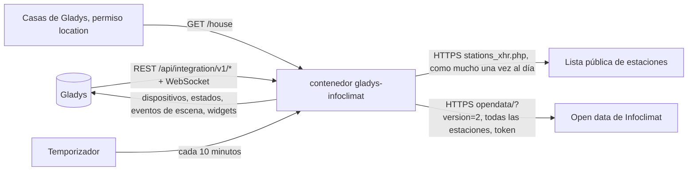
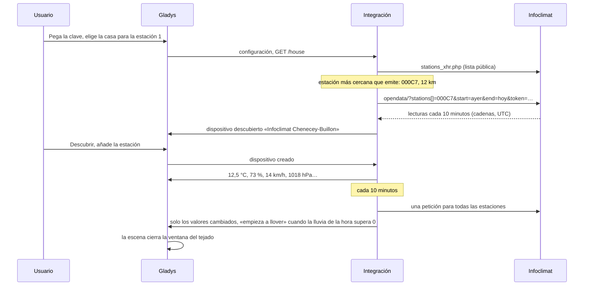
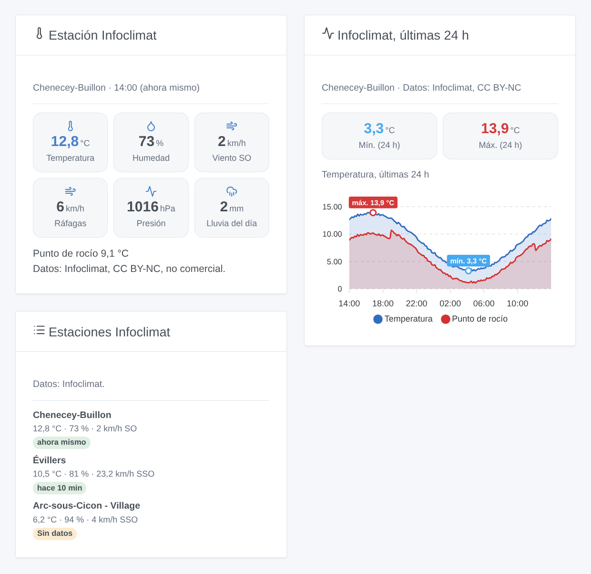

# Gladys Infoclimat

[English](README.md) · [Français](README.fr.md) · [Deutsch](README.de.md) · **Español**

[](LICENSE)
[](https://github.com/William-De71/gladys-infoclimat/releases)
[](https://github.com/William-De71/gladys-infoclimat/actions/workflows/release.yml)
[](https://gladysassistant.com)


Integración externa de [Gladys Assistant](https://gladysassistant.com) para las estaciones meteorológicas de [Infoclimat](https://www.infoclimat.fr), la asociación francesa cuyos miembros comparten sus estaciones (la red StatIC): temperatura, humedad, presión, viento, lluvia y más de las estaciones cercanas a sus casas, como dispositivos, escenas y widgets del panel. Lee la API open data de Infoclimat con su propia clave gratuita, con moderación: una petición para todas las estaciones cada 10 minutos.

Documentación de usuario: [English](docs/en.md) · [Français](docs/fr.md) · [Deutsch](docs/de.md) · [Español](docs/es.md).

Sin relación con Infoclimat. **Aún no probada con una clave real de Infoclimat**: las peticiones siguen la API open data, comprobada con sus respuestas reales sin clave; la lista pública de estaciones se leyó de verdad.

## Funciones

- Hasta **tres estaciones**: la estación StatIC más cercana a una casa de Gladys que haya emitido en las últimas 24 horas, o una estación elegida por su identificador (estaciones oficiales incluidas).
- **Un dispositivo por estación**, solo con las medidas que proporciona: temperatura, humedad, presión a nivel del mar, punto de rocío, viento medio, ráfagas, dirección del viento, lluvia de la última hora, lluvia del día, espesor de nieve, visibilidad. Una función que ya apareció nunca desaparece.
- **5 desencadenadores de escena** (empieza / deja de llover, estación sin datos / de vuelta, clave rechazada), **1 acción de escena** (leer una estación, con una frase lista para un mensaje) y **3 widgets del panel** (última lectura, últimas 24 horas de una medida, estaciones lado a lado).
- **Uso razonable** de una plataforma de voluntarios: una petición agrupada cada 10 minutos (15, 30 o 60), un User-Agent identificable, sin ráfaga al arrancar, esperas más largas tras los fallos.
- La mención de Infoclimat y la licencia de cada estación en los widgets.
- Cuatro idiomas en todas partes: inglés, francés, alemán, español.

## Cómo funciona




De una casa a una escena:



### Transporte

`transports: ["cloud"]`: las lecturas vienen de Infoclimat. **Los identificadores de sus estaciones y su clave se envían a Infoclimat**; la ubicación de sus casas nunca sale de Gladys (la estación más cercana se busca en la lista pública, dentro de la integración). Leer las casas necesita el permiso `location`, mostrado en la instalación. `/data` guarda las últimas 26 horas de lecturas de cada estación, las medidas que dio cada una, la lista pública de estaciones y la hora de la última petición.

## Dispositivos y funciones

| Dispositivo      | Funciones (categoría / tipo)                                                                                                                                                                                                                                                                                                                                                                             |
| ---------------- | -------------------------------------------------------------------------------------------------------------------------------------------------------------------------------------------------------------------------------------------------------------------------------------------------------------------------------------------------------------------------------------------------------- |
| Uno por estación | Temperatura (`temperature-sensor` / `decimal`, °C), humedad (`humidity-sensor`, %), presión (`pressure-sensor`, hPa), punto de rocío (`temperature-sensor` / `probe`), viento medio y ráfaga (`speed-sensor`, km/h), dirección del viento (`angle-sensor` / `integer`, °), lluvia de la hora y del día (`precipitation-sensor`, mm/h, mm/día), espesor de nieve y visibilidad (`distance-sensor`, cm, m) |

- Solo las medidas que proporciona la estación (listadas por Infoclimat y no siempre vacías); una función que ya apareció se mantiene, una lectura vacía nunca la elimina.
- El punto de rocío es una temperatura de tipo `probe`: nunca cuenta en la temperatura de una habitación.
- La lluvia del día: la columna de Infoclimat (desde las 0 h UTC), si no, la suma de las horas completas.
- Los identificadores externos se basan en el identificador de la estación (`ext:infoclimat:station:000c7`), nunca en un nombre ni en una casa. Una casa que cambia de estación obtiene un nuevo dispositivo.

## Desencadenadores, acciones y widgets



**Widgets**: Estación Infoclimat (la última lectura: hasta seis mosaicos, las demás medidas, la mención y la licencia), Infoclimat, últimas 24 h (temperatura con punto de rocío, humedad, presión, viento con ráfagas o lluvia, valores mínimo y máximo marcados), Estaciones Infoclimat (las estaciones lado a lado, una sin datos señalada). Sin botón de actualizar: solo el temporizador pregunta a Infoclimat.

**Desencadenadores** (un evento por transición, nunca en la primera lectura, nunca como consecuencia de una acción): empieza a llover, deja de llover (la lluvia de la última hora de una estación supera 0, vuelve a 0), estación sin datos (ninguna lectura desde hace 90 minutos), estación de vuelta, clave rechazada (una vez hasta que vuelva a funcionar). Filtro: la estación. Variables: estación, nombre, temperatura, lluvia de la hora y del día, hora de la lectura, minutos transcurridos.

Los valores (temperatura, ráfagas…) son funciones del dispositivo: «ráfagas por encima de 60 km/h» es un desencadenador de dispositivo de Gladys.

**Acción**: leer una estación (la última lectura, su hora y antigüedad, la dirección del viento como N, SO…, y una frase lista para un mensaje); nunca envía una petición.

Ejemplos:

- Cuando empieza a llover en la estación → cerrar la ventana del tejado, enviar «{{triggerEvent.data.rain_1h}} mm en la última hora».
- Cada mañana a las 7:00 → leer una estación → enviar el resumen.
- Cuando se rechaza la clave → avisar al administrador.

## Requisitos

- Gladys Assistant **5.2.0** o posterior (selector de casa, widgets y escenas de integraciones): las instancias más antiguas no pueden instalar la integración.
- Una **clave open data de Infoclimat** gratuita, solicitada en [infoclimat.fr/opendata](https://www.infoclimat.fr/opendata/).
- La ubicación de su casa en Gladys, o el identificador de una estación.

### Uso razonable y licencia

Infoclimat funciona gracias a voluntarios y pide un uso razonable: la integración lee todas sus estaciones en una petición como mucho cada 10 minutos, nunca desde un widget ni una escena, espera hasta una hora tras los fallos y solo reintenta una clave rechazada cada 6 horas. Una clave puede estar ligada a la dirección IP pública que la usa. Los datos son gratuitos para un uso personal, no comercial; muchas estaciones StatIC están bajo CC BY-NC: conserve la mención de Infoclimat. Las previsiones de Infoclimat (otra clave, otra API) quedan fuera del alcance.

## Instalación

- **Desde la tienda**: Integraciones → Infoclimat → Instalar.
- **Desde la URL del repositorio**: Integraciones → integración externa → `https://github.com/William-De71/gladys-infoclimat`.
- **Modo desarrollador**: ejecute `npm start` con las variables que da Gladys (ver Desarrollo).

## Configuración

| Campo o botón                                | Por defecto | Significado                                                                          |
| -------------------------------------------- | ----------- | ------------------------------------------------------------------------------------ |
| Clave open data                              | —           | Obligatoria, secreta                                                                 |
| Estación 1-3: Casa                           | —           | La estación StatIC más cercana a la casa que haya emitido en las últimas 24 h        |
| Estación 1-3: O un identificador de estación | —           | `000P2`, `STATIC0095`, una estación oficial; prevalece sobre la casa                 |
| Intervalo de lectura                         | 10 min      | 10, 15, 30 o 60                                                                      |
| Idioma de los textos                         | automático  | Nombres de dispositivos y funciones, textos de las escenas                           |
| Leer ahora / Diagnóstico                     | —           | Leer de inmediato (no dos veces en 2 minutos); el estado en los registros, sin clave |

## Uso

1. Solicite una clave en la página open data de Infoclimat y péguela (Integraciones → Infoclimat → Configuración).
2. Elija una casa, o escriba el identificador de una estación, para tres estaciones como máximo; pulse **Leer ahora**.
3. **Descubrir**, luego añada como dispositivos las estaciones que desee.
4. Añada los widgets a un panel y cree escenas con las funciones del dispositivo, los desencadenadores y la acción.

## Desarrollo

```bash
npm install
npm test                       # node --test, nunca accede a la red
npm run lint                   # ESLint
npm run format:check           # Prettier
npx github:GladysAssistant/integration-store . --skip-image-check
scripts/build-cover.sh         # cover.jpg desde docs/assets/cover.svg
docs/illustrations/render.sh   # docs/assets/widgets.<lang>.png
```

En local, el SDK lee `GLADYS_HOST_API_URL`, `GLADYS_INTEGRATION_TOKEN` y `GLADYS_INTEGRATION_SELECTOR` (dadas por Gladys en modo desarrollador), y la integración lee `TZ`. `DEBUG=gladys-integration-sdk` muestra los registros del SDK.

Las pruebas cubren el cliente HTTP (la petición, los rechazos reales de Infoclimat, una petición a la vez), la lista pública (un extracto real), el analizador (una respuesta con la forma real, identificadores escritos de otro modo), el historial (lluvia del día, valores actuales), los dispositivos (los campos que exige la pantalla Descubrir), los widgets (`validateWidgetContent`), los eventos y salidas de escena, el temporizador (arranque, intervalo, fallos, clave rechazada, reinicio), el manifiesto, los cuatro idiomas, el script de release, y la integración completa frente al Gladys falso del SDK y un Infoclimat falso. `test/structure.test.js` congela todas las claves que guardan los usuarios.

## Proceso de release


Cada fusión en `main` lanza la CI y luego calcula la versión a partir de los [Conventional Commits](https://www.conventionalcommits.org/) desde la última etiqueta: `feat` → menor, `fix` / `perf` → parche, `!` o `BREAKING CHANGE` → mayor (una menor por debajo de 1.0.0); `docs`, `chore`, `ci`, `test`, `style`, `refactor`, `build` solos no publican nada. Se genera la sección del changelog, se envía la etiqueta, se construye la imagen multiarquitectura, luego `main` recibe el commit de release, se crea la GitHub Release y un último job comprueba la imagen pública, el validador de la tienda y el topic.

- El título de la pull request se convierte en el commit squash y luego en la línea del changelog: escríbalo en inglés, para el usuario (`pr-title.yml` lo comprueba). Nunca edite `CHANGELOG.md` a mano.
- La 1.0.0 es una decisión: Actions → Release → Run workflow con `release-as: 1.0.0`. `dry-run` muestra la versión y las notas sin publicar.
- **Rama protegida**: la release envía su commit a `main` con `GITHUB_TOKEN`. El ruleset `protect-main` (sin borrado ni force-push) lo deja pasar; una regla más estricta (pull request obligatoria, status checks) necesitaría GitHub Actions en su lista de excepciones, o una GitHub App.
- Tras la primera release, haga público el paquete de `ghcr.io` (Package settings → Change visibility), o Gladys no podrá descargarlo.

## Solución de problemas

Ver [docs/es.md](docs/es.md#solución-de-problemas). Informe de los problemas con las versiones de Gladys y de la integración y el resultado de **Diagnóstico** (en los registros de la integración). Nunca pegue su clave.

## Contribuir

Las incidencias y pull requests son bienvenidas. Ejecute `npm run format:check && npm run lint && npm test` antes de abrir una pull request, y mantenga sin cambios todos los identificadores externos y claves guardadas (ver [CLAUDE.md](CLAUDE.md)).

## Seguridad

Ver [SECURITY.md](SECURITY.md): informe de las vulnerabilidades en privado. La clave es un campo `secret`: nunca se registra, nunca se escribe en `/data`, solo se envía a `www.infoclimat.fr` (la API la recibe en la URL) y se elimina de los mensajes de error de Infoclimat. La ubicación de las casas nunca se registra ni se envía.

## Capturas próximas

Las imágenes anteriores son ilustraciones, no capturas de pantalla. Las capturas reales irán en `docs/assets/screenshots/` (PNG, 1280 × 800): `configuration.png`, `discovery.png`, `device.png` (una estación con sus funciones), `scene.png` (el desencadenador «empieza a llover»).

## Licencia

[Apache License 2.0](LICENSE) — ver también [NOTICE](NOTICE). Los datos pertenecen a Infoclimat y a los propietarios de las estaciones, bajo la licencia de cada estación. Gracias a la documentación y al SDK de Gladys, y a la asociación Infoclimat por su open data.
