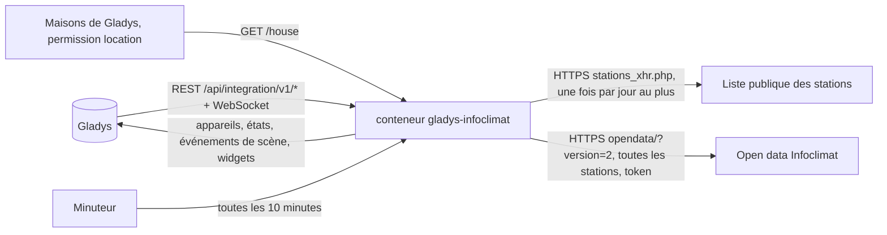
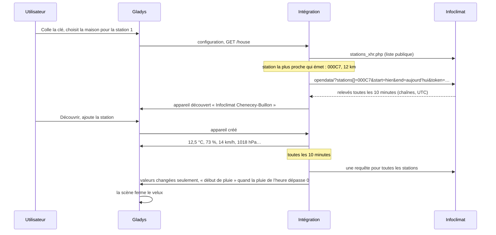
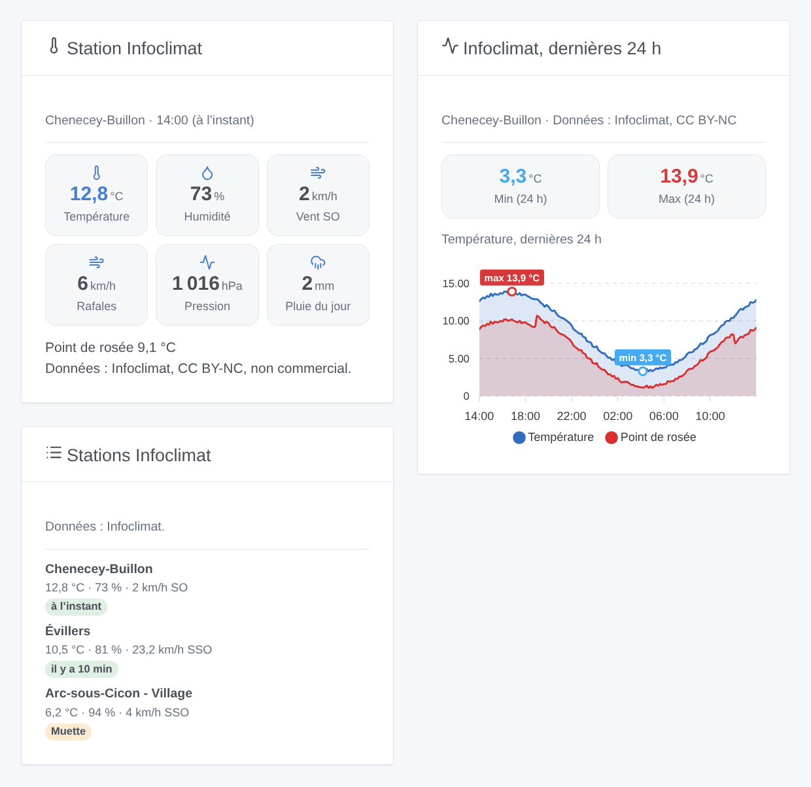

# Gladys Infoclimat

[English](README.md) · **Français** · [Deutsch](README.de.md) · [Español](README.es.md)

[](LICENSE)
[](https://github.com/William-De71/gladys-infoclimat/releases)
[](https://github.com/William-De71/gladys-infoclimat/actions/workflows/release.yml)
[](https://gladysassistant.com)


Intégration externe [Gladys Assistant](https://gladysassistant.com) pour les stations météo d’[Infoclimat](https://www.infoclimat.fr), l’association dont les membres partagent leurs stations (le réseau StatIC) : température, humidité, pression, vent, pluie et plus, depuis les stations proches de vos maisons, en appareils, scènes et widgets de tableau de bord. Elle lit l’API open data d’Infoclimat avec votre propre clé gratuite, avec mesure : une requête pour toutes les stations toutes les 10 minutes.

Documentation utilisateur : [English](docs/en.md) · [Français](docs/fr.md) · [Deutsch](docs/de.md) · [Español](docs/es.md).

Sans lien avec Infoclimat. **Pas encore testée avec une vraie clé Infoclimat** : les requêtes suivent l’API open data, vérifiée sur ses vraies réponses sans clé ; la liste publique des stations a été lue pour de vrai.

## Fonctionnalités

- Jusqu’à **trois stations** : la station StatIC la plus proche d’une maison de Gladys ayant émis dans les dernières 24 heures, ou une station choisie par son identifiant (stations officielles comprises).
- **Un appareil par station**, avec seulement les mesures qu’elle fournit : température, humidité, pression au niveau de la mer, point de rosée, vent moyen, rafales, direction du vent, pluie de la dernière heure, pluie du jour, neige au sol, visibilité. Une fonctionnalité apparue ne disparaît jamais.
- **5 déclencheurs de scène** (début / fin de pluie, station muette / revenue, clé refusée), **1 action de scène** (lire une station, avec une phrase prête à envoyer) et **3 widgets de tableau de bord** (dernier relevé, dernières 24 heures d’une mesure, stations côte à côte).
- **Usage raisonnable** d’une plateforme bénévole : une requête groupée toutes les 10 minutes (15, 30 ou 60), un User-Agent identifiable, pas de rafale au démarrage, des attentes plus longues après les échecs.
- Le crédit d’Infoclimat et la licence de chaque station dans les widgets.
- Quatre langues partout : anglais, français, allemand, espagnol.

## Fonctionnement




D’une maison à une scène :



### Transport

`transports: ["cloud"]` : les relevés viennent d’Infoclimat. **Les identifiants de vos stations et votre clé sont envoyés à Infoclimat** ; la position de vos maisons ne quitte jamais Gladys (la station la plus proche est cherchée dans la liste publique, à l’intérieur de l’intégration). Lire les maisons demande la permission `location`, affichée à l’installation. `/data` garde les 26 dernières heures de relevés de chaque station, les mesures fournies par chacune, la liste publique des stations et l’heure de la dernière requête.

## Appareils et fonctionnalités

| Appareil       | Fonctionnalités (catégorie / type)                                                                                                                                                                                                                                                                                                                                                               |
| -------------- | ------------------------------------------------------------------------------------------------------------------------------------------------------------------------------------------------------------------------------------------------------------------------------------------------------------------------------------------------------------------------------------------------ |
| Un par station | Température (`temperature-sensor` / `decimal`, °C), humidité (`humidity-sensor`, %), pression (`pressure-sensor`, hPa), point de rosée (`temperature-sensor` / `probe`), vent moyen et rafale (`speed-sensor`, km/h), direction du vent (`angle-sensor` / `integer`, °), pluie de l’heure et du jour (`precipitation-sensor`, mm/h, mm/j), neige au sol et visibilité (`distance-sensor`, cm, m) |

- Seulement les mesures fournies par la station (listées par Infoclimat et pas toujours vides) ; une fonctionnalité apparue reste, un relevé vide ne la retire jamais.
- Le point de rosée est une température `probe` : il ne compte jamais dans la température d’une pièce.
- La pluie du jour : la colonne d’Infoclimat (depuis 0 h UTC), sinon la somme des heures pleines.
- Les identifiants externes reposent sur l’identifiant de la station (`ext:infoclimat:station:000c7`), jamais sur un nom ni sur une maison. Une maison qui change de station obtient un nouvel appareil.

## Déclencheurs, actions de scène et widgets



**Widgets** : Station Infoclimat (le dernier relevé : jusqu’à six tuiles, les autres mesures, le crédit et la licence), Infoclimat, dernières 24 h (température avec point de rosée, humidité, pression, vent avec rafales ou pluie, valeurs extrêmes marquées), Stations Infoclimat (les stations côte à côte, une station muette signalée). Pas de bouton de rafraîchissement : seul le minuteur interroge Infoclimat.

**Déclencheurs** (un événement par transition, jamais à la première lecture, jamais à la suite d’une action) : début de pluie, fin de pluie (la pluie de la dernière heure d’une station dépasse 0, retombe à 0), station muette (aucun relevé depuis 90 minutes), station revenue, clé refusée (une fois jusqu’à ce qu’elle remarche). Filtre : la station. Variables : station, nom, température, pluie de l’heure et du jour, heure du relevé, minutes écoulées.

Les valeurs (température, rafales…) sont des fonctionnalités d’appareil : « rafales au-dessus de 60 km/h » est un déclencheur d’appareil de Gladys.

**Action** : lire une station (le dernier relevé, son heure et son âge, la direction du vent en N, SO…, et une phrase prête à envoyer) ; elle n’envoie jamais de requête.

Exemples :

- Quand la pluie commence à la station → fermer le velux, envoyer « {{triggerEvent.data.rain_1h}} mm sur la dernière heure ».
- Chaque matin à 7 h → lire une station → envoyer le résumé.
- Quand la clé est refusée → prévenir l’administrateur.

## Prérequis

- Gladys Assistant **5.2.0** ou plus récent (sélecteur de maison, widgets et scènes des intégrations) : les instances plus anciennes ne peuvent pas installer l’intégration.
- Une **clé open data Infoclimat** gratuite, demandée sur [infoclimat.fr/opendata](https://www.infoclimat.fr/opendata/).
- La position de votre maison dans Gladys, ou l’identifiant d’une station.

### Usage raisonnable et licence

Infoclimat fonctionne grâce à des bénévoles et demande un usage raisonnable : l’intégration lit toutes ses stations en une requête toutes les 10 minutes au plus, jamais depuis un widget ni une scène, attend jusqu’à une heure après les échecs, et ne réessaie une clé refusée que toutes les 6 heures. Une clé peut être liée à l’adresse IP publique qui l’utilise. Les données sont gratuites pour un usage personnel, non commercial ; beaucoup de stations StatIC sont sous CC BY-NC : gardez le crédit d’Infoclimat. Les prévisions d’Infoclimat (autre clé, autre API) sont hors périmètre.

## Installation

- **Depuis le store** : Intégrations → Infoclimat → Installer.
- **Depuis l’URL du dépôt** : Intégrations → intégration externe → `https://github.com/William-De71/gladys-infoclimat`.
- **Mode développeur** : lancez `npm start` avec les variables fournies par Gladys (voir Développement).

## Configuration

| Champ ou bouton                            | Par défaut  | Rôle                                                                                 |
| ------------------------------------------ | ----------- | ------------------------------------------------------------------------------------ |
| Clé open data                              | —           | Obligatoire, secrète                                                                 |
| Station 1-3 : Maison                       | —           | La station StatIC la plus proche de la maison ayant émis dans les dernières 24 h     |
| Station 1-3 : Ou un identifiant de station | —           | `000P2`, `STATIC0095`, une station officielle ; prioritaire sur la maison            |
| Intervalle de lecture                      | 10 min      | 10, 15, 30 ou 60                                                                     |
| Langue des textes                          | automatique | Noms des appareils et des fonctionnalités, textes des scènes                         |
| Lire maintenant / Diagnostic               | —           | Lire tout de suite (pas deux fois en 2 minutes) ; l’état dans les journaux, sans clé |

## Utilisation

1. Demandez une clé sur la page open data d’Infoclimat et collez-la (Intégrations → Infoclimat → Configuration).
2. Choisissez une maison, ou saisissez l’identifiant d’une station, pour trois stations au plus ; appuyez sur **Lire maintenant**.
3. **Découvrir**, puis ajoutez les stations voulues comme appareils.
4. Ajoutez les widgets à un tableau de bord, et créez des scènes avec les fonctionnalités, les déclencheurs et l’action.

## Développement

```bash
npm install
npm test                       # node --test, ne touche jamais le réseau
npm run lint                   # ESLint
npm run format:check           # Prettier
npx github:GladysAssistant/integration-store . --skip-image-check
scripts/build-cover.sh         # cover.jpg depuis docs/assets/cover.svg
docs/illustrations/render.sh   # docs/assets/widgets.<lang>.png
```

En local, le SDK lit `GLADYS_HOST_API_URL`, `GLADYS_INTEGRATION_TOKEN` et `GLADYS_INTEGRATION_SELECTOR` (fournies par Gladys en mode développeur), et l’intégration lit `TZ`. `DEBUG=gladys-integration-sdk` affiche les journaux du SDK.

Les tests couvrent le client HTTP (la requête, les vrais refus d’Infoclimat, une requête à la fois), la liste publique (un extrait réel), le parseur (une réponse de la forme réelle, des identifiants écrits différemment), l’historique (pluie du jour, valeurs actuelles), les appareils (les champs exigés par l’écran Découvrir), les widgets (`validateWidgetContent`), les événements et sorties de scène, le minuteur (démarrage, intervalle, échecs, clé refusée, redémarrage), le manifeste, les quatre langues, le script de release, et l’intégration entière face au faux Gladys du SDK et à un faux Infoclimat. `test/structure.test.js` fige toutes les clés stockées chez les utilisateurs.

## Processus de release


Chaque fusion sur `main` lance la CI, puis calcule la version depuis les [Conventional Commits](https://www.conventionalcommits.org/) depuis le dernier tag : `feat` → mineure, `fix` / `perf` → correctif, `!` ou `BREAKING CHANGE` → majeure (une mineure sous 1.0.0) ; `docs`, `chore`, `ci`, `test`, `style`, `refactor`, `build` seuls ne publient rien. La section du changelog est générée, le tag poussé, l’image multi-architecture construite, puis `main` reçoit le commit de release, la release GitHub est créée et un dernier job vérifie l’image publique, le validateur du store et le topic.

- Le titre de la pull request devient le commit squash, puis la ligne du changelog : écrivez-le en anglais, pour l’utilisateur (`pr-title.yml` le vérifie). N’éditez jamais `CHANGELOG.md` à la main.
- La 1.0.0 est une décision : Actions → Release → Run workflow avec `release-as: 1.0.0`. `dry-run` montre la version et les notes sans rien publier.
- **Branche protégée** : la release pousse son commit sur `main` avec `GITHUB_TOKEN`. Le ruleset `protect-main` (ni suppression ni force-push) le laisse passer ; une règle plus stricte (pull request obligatoire, status checks) demanderait d’ajouter GitHub Actions aux contournements, ou une GitHub App.
- Après la première release, rendez public le package `ghcr.io` (Package settings → Change visibility), sinon Gladys ne peut pas le télécharger.

## Dépannage

Voir [docs/fr.md](docs/fr.md#dépannage). Signalez les problèmes avec les versions de Gladys et de l’intégration et le résultat de **Diagnostic** (dans les journaux de l’intégration). Ne collez jamais votre clé.

## Contribuer

Tickets et pull requests bienvenus. Lancez `npm run format:check && npm run lint && npm test` avant d’ouvrir une pull request, et gardez inchangés tous les identifiants externes et clés stockées (voir [CLAUDE.md](CLAUDE.md)).

## Sécurité

Voir [SECURITY.md](SECURITY.md) : signalez les vulnérabilités en privé. La clé est un champ `secret` : jamais journalisée, jamais écrite dans `/data`, envoyée seulement à `www.infoclimat.fr` (l’API la prend dans l’URL), et retirée des messages d’erreur d’Infoclimat. La position des maisons n’est jamais journalisée ni envoyée.

## Captures à venir

Les images ci-dessus sont des illustrations, pas des captures d’écran. Les vraies captures iront dans `docs/assets/screenshots/` (PNG, 1280 × 800) : `configuration.png`, `discovery.png`, `device.png` (une station et ses fonctionnalités), `scene.png` (le déclencheur « début de pluie »).

## Licence

[Licence Apache 2.0](LICENSE) — voir aussi [NOTICE](NOTICE). Les données appartiennent à Infoclimat et aux propriétaires des stations, sous la licence de chaque station. Merci à la documentation et au SDK de Gladys, et à l’association Infoclimat pour son open data.
