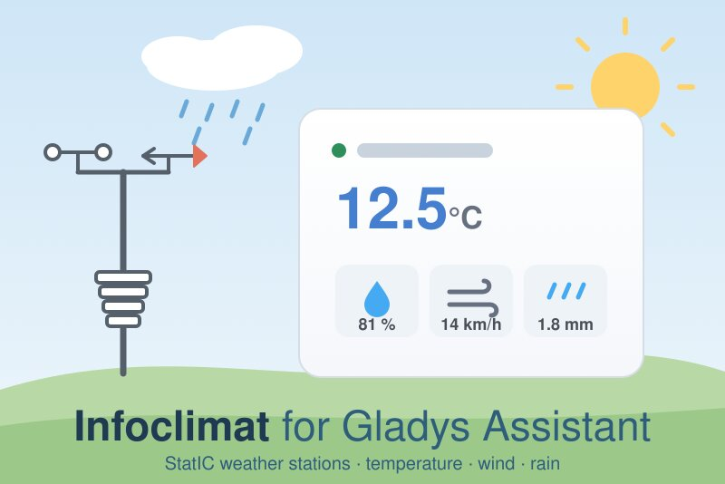
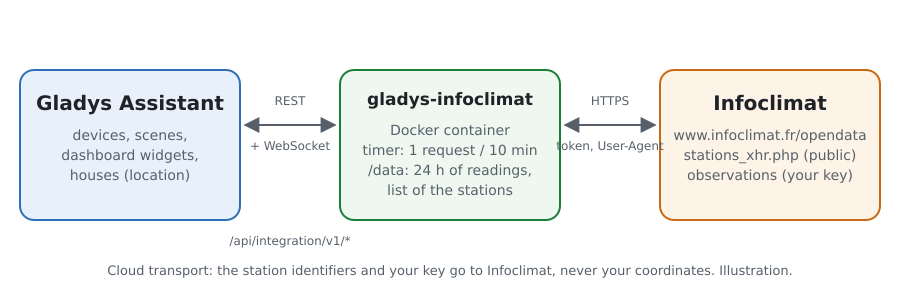
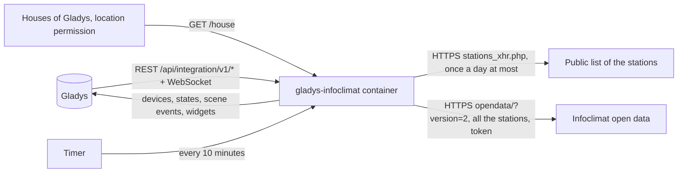
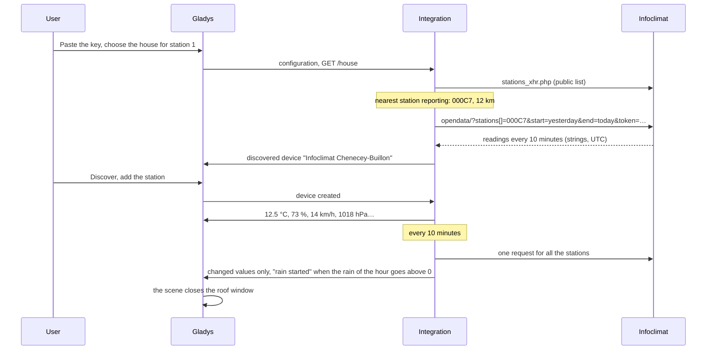
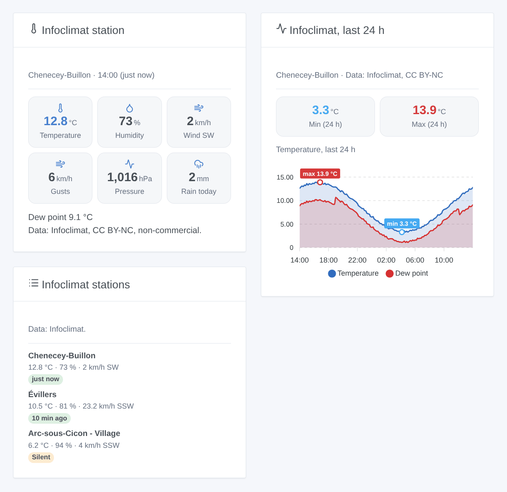

# Gladys Infoclimat

**English** · [Français](README.fr.md) · [Deutsch](README.de.md) · [Español](README.es.md)

[](LICENSE)
[](https://github.com/William-De71/gladys-infoclimat/releases)
[](https://github.com/William-De71/gladys-infoclimat/actions/workflows/release.yml)
[](https://gladysassistant.com)



[Gladys Assistant](https://gladysassistant.com) external integration for the weather stations of [Infoclimat](https://www.infoclimat.fr), the French association whose members share their stations (the StatIC network): temperature, humidity, pressure, wind, rain and more from the stations near your houses, as devices, scenes and dashboard widgets. It reads the open data API of Infoclimat with your own free key, sparingly: one request for all the stations every 10 minutes.

User documentation: [English](docs/en.md) · [Français](docs/fr.md) · [Deutsch](docs/de.md) · [Español](docs/es.md).

Not affiliated with Infoclimat. **Not tested with a real Infoclimat key yet**: the requests follow the open data API, checked against its real answers without a key; the public list of the stations was read for real.

## Features

- Up to **three stations**: the nearest StatIC station of a house of Gladys that reported in the last 24 hours, or a station chosen by its identifier (official stations included).
- **One device per station**, with only the measures it gives: temperature, humidity, sea-level pressure, dew point, mean wind, gusts, wind direction, rain over the last hour, rain of the day, snow depth, visibility. A feature once given never disappears.
- **5 scene triggers** (rain started / stopped, station silent / back, key refused), **1 scene action** (read a station, with a sentence ready for a message) and **3 dashboard widgets** (latest reading, last 24 hours of a measure, stations side by side).
- **Fair use** of a volunteer platform: one grouped request every 10 minutes (15, 30 or 60), an identifiable User-Agent, no burst at startup, longer waits after failures.
- The credit of Infoclimat and the license of each station in the widgets.
- Four languages everywhere: English, French, German, Spanish.

## How it works





From a house to a scene:



### Transport

`transports: ["cloud"]`: the readings come from Infoclimat. **The identifiers of your stations and your key are sent to Infoclimat**; the location of your houses never leaves Gladys (the nearest station is found in the public list, inside the integration). Reading the houses needs the `location` permission, shown on the install screen. `/data` keeps the last 26 hours of readings of each station, the measures each one gave, the public list of the stations and the time of the last request.

## Devices and features

| Device          | Features (category / type)                                                                                                                                                                                                                                                                                                                                                                  |
| --------------- | ------------------------------------------------------------------------------------------------------------------------------------------------------------------------------------------------------------------------------------------------------------------------------------------------------------------------------------------------------------------------------------------- |
| One per station | Temperature (`temperature-sensor` / `decimal`, °C), humidity (`humidity-sensor`, %), pressure (`pressure-sensor`, hPa), dew point (`temperature-sensor` / `probe`), mean wind and gust (`speed-sensor`, km/h), wind direction (`angle-sensor` / `integer`, °), rain of the hour and of the day (`precipitation-sensor`, mm/h, mm/day), snow depth and visibility (`distance-sensor`, cm, m) |

- Only the measures the station gives (listed by Infoclimat and not always empty); a feature once given stays, an empty reading never removes it.
- The dew point is a `probe` temperature: it never counts in the temperature of a room.
- The rain of the day: the column of Infoclimat (since 00:00 UTC), otherwise the sum of the full hours.
- External ids rest on the identifier of the station (`ext:infoclimat:station:000c7`), never on a name nor on a house. A house that changes station gets a new device.

## Scene triggers, actions and widgets



**Widgets**: Infoclimat station (the latest reading: up to six tiles, the other measures, the credit and license), Infoclimat, last 24 h (temperature with dew point, humidity, pressure, wind with gusts or rain, lowest and highest values marked), Infoclimat stations (the stations side by side, a silent one flagged). No refresh button: the timer is the only one to ask Infoclimat.

**Triggers** (one event per transition, never at the first reading, never as the result of an action): rain started, rain stopped (the rain of the last hour at a station goes above 0, falls back to 0), station silent (no reading for 90 minutes), station back, key refused (once until it works again). Filter: the station. Variables: station, name, temperature, rain of the hour and of the day, time of the reading, minutes since.

The values (temperature, gusts…) are device features: "gusts above 60 km/h" is a device trigger of Gladys.

**Action**: read a station (the latest reading, its time and age, the wind direction as N, SW…, and a sentence ready for a message); it never sends a request.

Examples:

- When rain starts at the station → close the roof window, send "{{triggerEvent.data.rain_1h}} mm in the last hour".
- Every morning at 7:00 → read a station → send the summary.
- When the key is refused → notify the administrator.

## Requirements

- Gladys Assistant **5.3.0** or later (catalog keywords and countries of Gladys 5.3, house picker, widgets and scenes of integrations): older instances cannot install the integration.
- A free **Infoclimat open data key**, requested on [infoclimat.fr/opendata](https://www.infoclimat.fr/opendata/).
- The location of your house set in Gladys, or the identifier of a station.

### Fair use and license

Infoclimat is run by volunteers and asks for a fair use: the integration reads all its stations in one request every 10 minutes at most, never on a widget nor on a scene, waits up to an hour after failures, and tries a refused key every 6 hours only. A key may be bound to the public IP address that uses it. The data are free for a personal, non-commercial use; many StatIC stations are under CC BY-NC: keep the credit of Infoclimat. The forecasts of Infoclimat (another key, another API) are out of scope.

## Installation

- **From the store**: Integrations → Infoclimat → Install.
- **From the repository URL**: Integrations → external integration → `https://github.com/William-De71/gladys-infoclimat`.
- **Developer mode**: run `npm start` with the variables given by Gladys (see Development).

## Configuration

| Field or button                      | Default   | Meaning                                                                       |
| ------------------------------------ | --------- | ----------------------------------------------------------------------------- |
| Open data key                        | —         | Required, a secret                                                            |
| Station 1-3: House                   | —         | The nearest StatIC station of the house that reported in the last 24 hours    |
| Station 1-3: Or a station identifier | —         | `000P2`, `STATIC0095`, an official station; wins over the house               |
| Reading interval                     | 10 min    | 10, 15, 30 or 60                                                              |
| Language of the texts                | automatic | Device and feature names, scene texts                                         |
| Read now / Diagnostic                | —         | Read at once (not twice within 2 minutes); the state in the logs, without key |

## Usage

1. Request a key on the open data page of Infoclimat and paste it (Integrations → Infoclimat → Configuration).
2. Choose a house, or type the identifier of a station, for up to three stations; press **Read now**.
3. **Discover**, then add the stations you want as devices.
4. Add the widgets to a dashboard, and build scenes with the device features, the triggers and the action.

## Development

```bash
npm install
npm test                       # node --test, never touches the network
npm run lint                   # ESLint
npm run format:check           # Prettier
npx github:GladysAssistant/integration-store . --skip-image-check
scripts/build-cover.sh         # cover.jpg from docs/assets/cover.svg
docs/illustrations/render.sh   # docs/assets/widgets.<lang>.png
```

Locally, the SDK reads `GLADYS_HOST_API_URL`, `GLADYS_INTEGRATION_TOKEN` and `GLADYS_INTEGRATION_SELECTOR` (given by Gladys in developer mode), and the integration reads `TZ`. `DEBUG=gladys-integration-sdk` shows the SDK logs.

The tests cover the HTTP client (the request, the real refusals of Infoclimat, one request at a time), the public list (a real extract), the parser (an answer of the real shape, ids written differently), the history (rain of the day, current values), the devices (the fields the Discovery screen requires), the widgets (`validateWidgetContent`), the scene events and outputs, the timer (startup, interval, failures, refused key, restart), the manifest, the four languages, the release script, and the whole integration against the fake Gladys of the SDK and a fake Infoclimat. `test/structure.test.js` freezes every key users store.

## Release process


Every merge on `main` runs the CI, then computes the version from the [Conventional Commits](https://www.conventionalcommits.org/) since the last tag: `feat` → minor, `fix` / `perf` → patch, `!` or `BREAKING CHANGE` → major (a minor below 1.0.0); `docs`, `chore`, `ci`, `test`, `style`, `refactor`, `build` alone publish nothing. The changelog section is generated, the tag pushed, the multi-architecture image built, then `main` receives the release commit, the GitHub Release is created and a last job checks the public image, the store validator and the topic.

- The pull request title becomes the squash commit, then the changelog line: write it in English, for the user (`pr-title.yml` checks it). Never edit `CHANGELOG.md` by hand.
- 1.0.0 is a decision: Actions → Release → Run workflow with `release-as: 1.0.0`. `dry-run` shows the version and the notes without publishing.
- **Protected branch**: the release pushes its commit to `main` with `GITHUB_TOKEN`. The `protect-main` ruleset (no deletion, no force-push) lets it through; a stricter rule (pull request required, status checks) would need GitHub Actions in its bypass list, or a GitHub App.
- After the first release, make the `ghcr.io` package public (Package settings → Change visibility), or Gladys cannot pull it.

## Troubleshooting

See [docs/en.md](docs/en.md#troubleshooting). Report issues with the versions of Gladys and of the integration and the result of **Diagnostic** (in the logs of the integration). Never paste your key.

## Contributing

Issues and pull requests are welcome. Run `npm run format:check && npm run lint && npm test` before opening a pull request, and keep every external id and stored key unchanged (see [CLAUDE.md](CLAUDE.md)).

## Security

See [SECURITY.md](SECURITY.md): report vulnerabilities privately. The key is a `secret` field: never logged, never written to `/data`, sent only to `www.infoclimat.fr` (the API takes it in the query string), and removed from the error messages of Infoclimat. The location of the houses is never logged nor sent.

## Screenshots to come

The images above are illustrations, not screenshots. Real screenshots will go in `docs/assets/screenshots/` (PNG, 1280 × 800): `configuration.png`, `discovery.png`, `device.png` (a station with its features), `scene.png` (the "rain started" trigger).

## License

[Apache License 2.0](LICENSE) — see also [NOTICE](NOTICE). The data belong to Infoclimat and to the owners of the stations, under the license of each station. Thanks to the Gladys documentation and SDK, and to the Infoclimat association for its open data.
